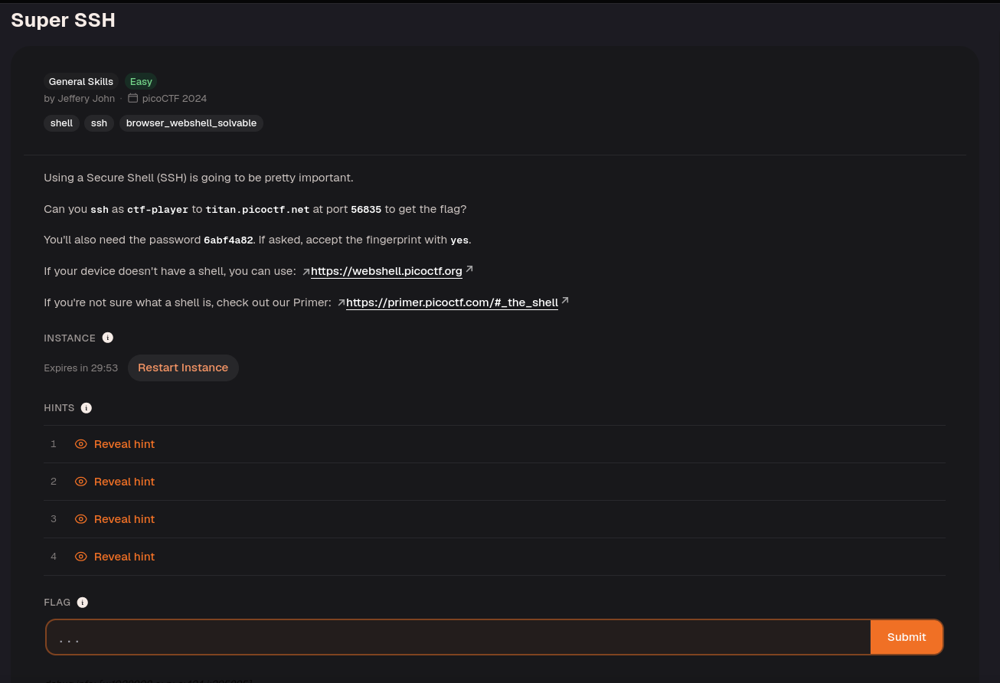
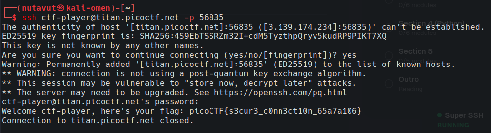

Use this command:

```bash
ssh ctf-player@titan.picoctf.net -p 56835
```

Type `yes` to accept the host key, then enter the password.

`ctf-player` is the remote username, and `-p 56835` selects the challenge's SSH port. SSH opens an encrypted terminal session on the remote machine.



---
