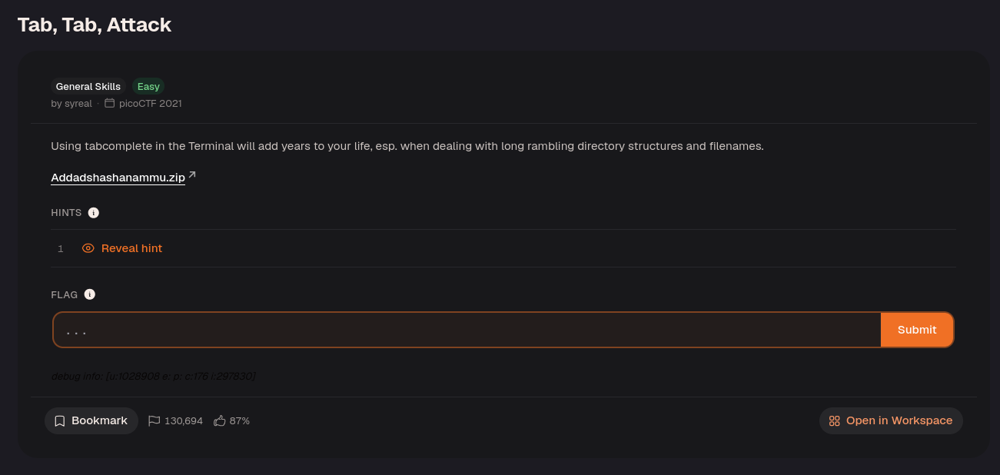
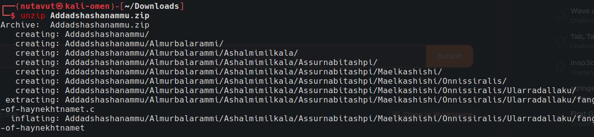
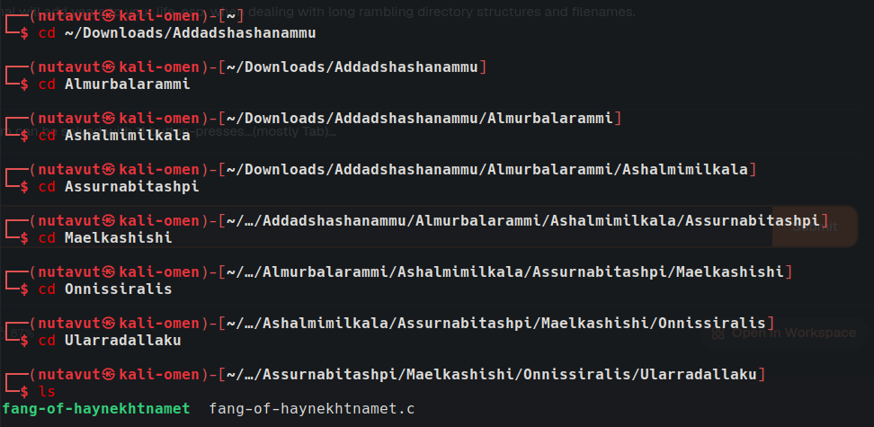
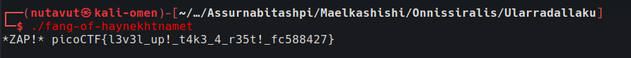

Download the ZIP file and extract it with `unzip`. Then use `cd` to navigate to the innermost folder and execute `fang-of-heynekhtnamet` to get the flag.

Press Tab to complete directory and file names instead of typing each long name manually. Use `./` before an executable in the current directory to run it.

---
