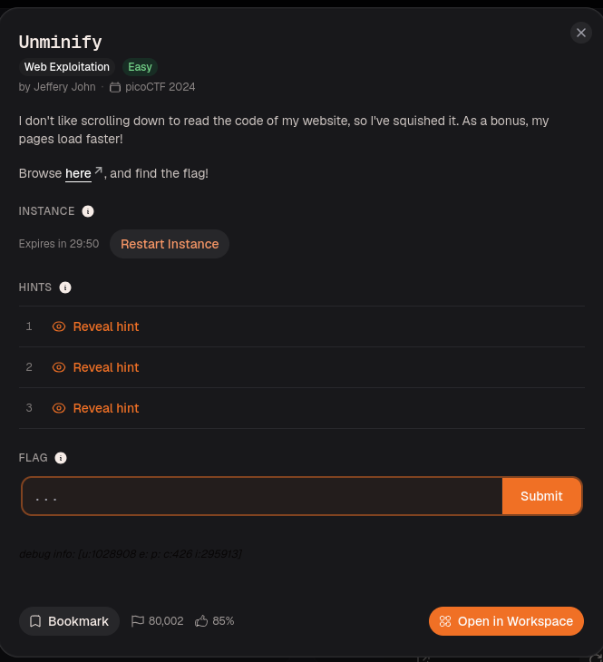
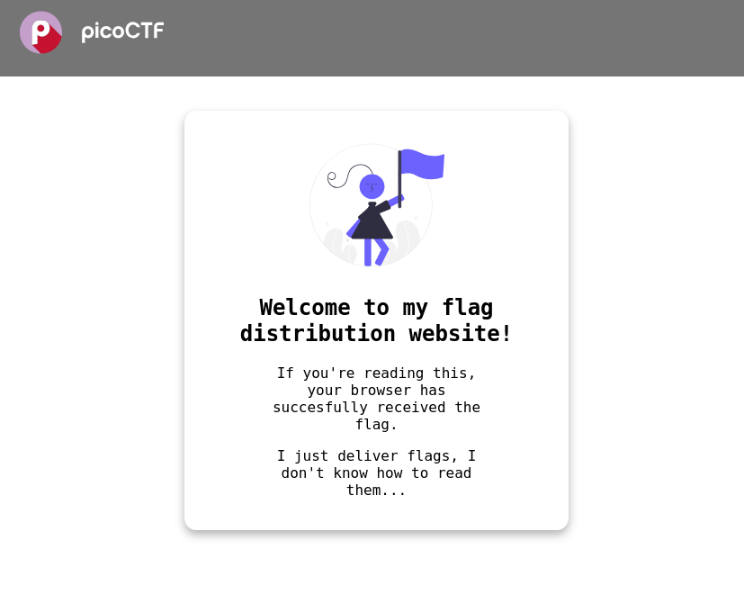
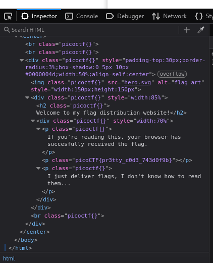

Inspect the page to find the flag in a `
` element.

Minification removes formatting to make source code smaller, but it does not conceal its contents. Search the page source or the browser's Elements panel for `picoCTF` to locate the flag.

*DONE!!!*

---
