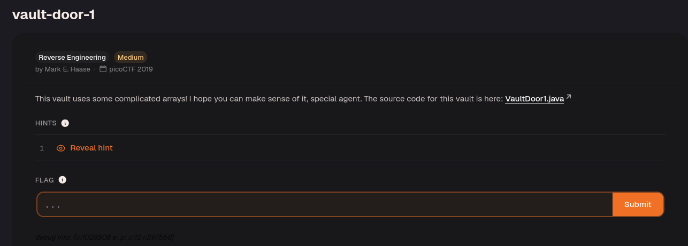

Download the Java file.

```java
import java.util.*;

  

class VaultDoor1 {

public static void main(String args[]) {

VaultDoor1 vaultDoor = new VaultDoor1();

Scanner scanner = new Scanner(System.in);

System.out.print("Enter vault password: ");

String userInput = scanner.next();

String input = userInput.substring("picoCTF{".length(),userInput.length()-1);

if (vaultDoor.checkPassword(input)) {

System.out.println("Access granted.");

} else {

System.out.println("Access denied!");

}

}

  

// I came up with a more secure way to check the password without putting

// the password itself in the source code. I think this is going to be

// UNHACKABLE!! I hope Dr. Evil agrees...

//

// -Minion #8728

public boolean checkPassword(String password) {

return password.length() == 32 &&

password.charAt(0) == 'd' &&

password.charAt(29) == 'c' &&

password.charAt(4) == 'r' &&

password.charAt(2) == '5' &&

password.charAt(23) == 'r' &&

password.charAt(3) == 'c' &&

password.charAt(17) == '4' &&

password.charAt(1) == '3' &&

password.charAt(7) == 'b' &&

password.charAt(10) == '_' &&

password.charAt(5) == '4' &&

password.charAt(9) == '3' &&

password.charAt(11) == 't' &&

password.charAt(15) == 'c' &&

password.charAt(8) == 'l' &&

password.charAt(12) == 'H' &&

password.charAt(20) == 'c' &&

password.charAt(14) == '_' &&

password.charAt(6) == 'm' &&

password.charAt(24) == '5' &&

password.charAt(18) == 'r' &&

password.charAt(13) == '3' &&

password.charAt(19) == '4' &&

password.charAt(21) == 'T' &&

password.charAt(16) == 'H' &&

password.charAt(27) == '7' &&

password.charAt(30) == '3' &&

password.charAt(25) == '_' &&

password.charAt(22) == '3' &&

password.charAt(28) == '9' &&

password.charAt(26) == 'e' &&

password.charAt(31) == '8';

}

}
```

The code already specified the correct character at each password position.

The password had to be 32 characters long. The first character was `d`, the second was `3`, and so on for all 32 positions.

`d35cr4mbl3_tH3_cH4r4cT3r5_e79c38`

Reconstruct the characters in order to recover the password!

So, the flag = `picoCTF{d35cr4mbl3_tH3_cH4r4cT3r5_e79c38}`

---
