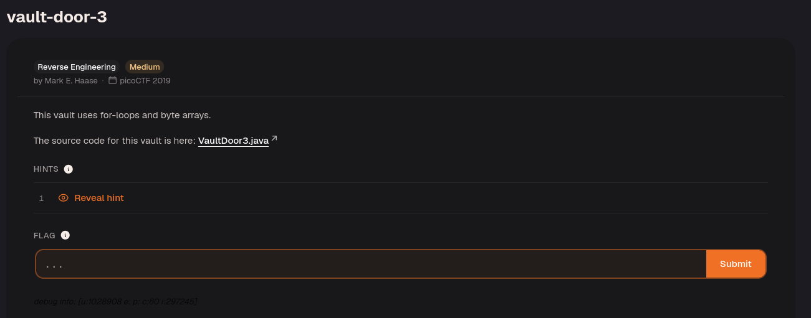

Download the Java file.

The password check rearranges 32 input characters before comparing them with a fixed string. To reverse it, map each character of that fixed string back to the original password index used by the loops: positions 0–7 stay unchanged, 8–15 are reversed, even positions 16–30 use `46-i`, and odd positions 17–31 stay unchanged. This recovers the password body; wrap it in `picoCTF{...}`.

```java
import java.util.*;

  

class VaultDoor3 {

public static void main(String args[]) {

VaultDoor3 vaultDoor = new VaultDoor3();

Scanner scanner = new Scanner(System.in);

System.out.print("Enter vault password: ");

String userInput = scanner.next();

String input = userInput.substring("picoCTF{".length(),userInput.length()-1);

if (vaultDoor.checkPassword(input)) {

System.out.println("Access granted.");

} else {

System.out.println("Access denied!");

}

}

  

// Our security monitoring team has noticed some intrusions on some of the

// less secure doors. Dr. Evil has asked me specifically to build a stronger

// vault door to protect his Doomsday plans. I just *know* this door will

// keep all of those nosy agents out of our business. Mwa ha!

//

// -Minion #2671

public boolean checkPassword(String password) {

if (password.length() != 32) {

return false;

}

char[] buffer = new char[32];

int i;

for (i=0; i<8; i++) {

buffer[i] = password.charAt(i);

}

for (; i<16; i++) {

buffer[i] = password.charAt(23-i);

}

for (; i<32; i+=2) {

buffer[i] = password.charAt(46-i);

}

for (i=31; i>=17; i-=2) {

buffer[i] = password.charAt(i);

}

String s = new String(buffer);

return s.equals("jU5t_a_sna_3lpm1cg04e_u_4_m6rb42");

}

}
```

---
