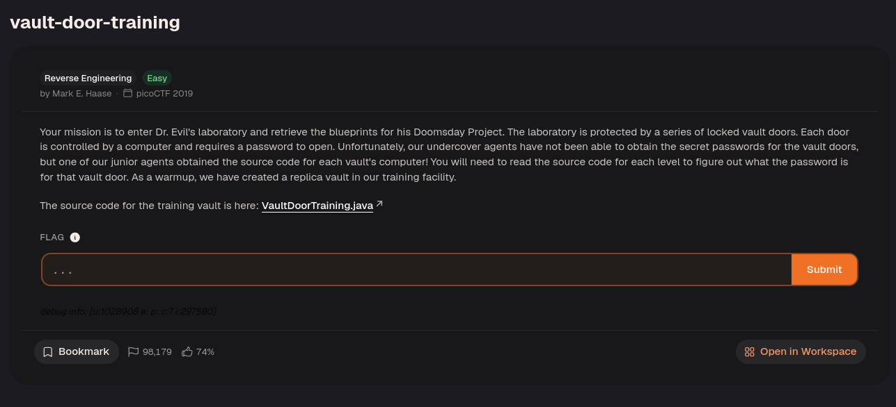

Download the source code.

```java
import java.util.*;

  

class VaultDoorTraining {

public static void main(String args[]) {

VaultDoorTraining vaultDoor = new VaultDoorTraining();

Scanner scanner = new Scanner(System.in);

System.out.print("Enter vault password: ");

String userInput = scanner.next();

String input = userInput.substring("picoCTF{".length(),userInput.length()-1);

if (vaultDoor.checkPassword(input)) {

System.out.println("Access granted.");

} else {

System.out.println("Access denied!");

}

}

  

// The password is below. Is it safe to put the password in the source code?

// What if somebody stole our source code? Then they would know what our

// password is. Hmm... I will think of some ways to improve the security

// on the other doors.

//

// -Minion #9567

public boolean checkPassword(String password) {

return password.equals("w4rm1ng_Up_w1tH_jAv4_000HPpgh7Ph");

}

}
```

The password was already present in the source code, so the flag was:
`picoCTF{w4rm1ng_Up_w1tH_jAv4_000HPpgh7Ph}`

---
