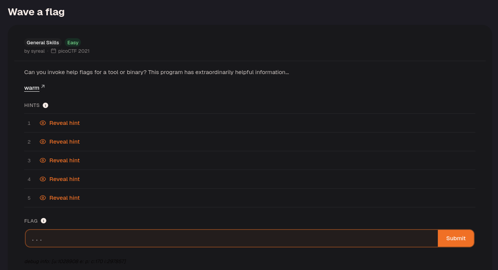
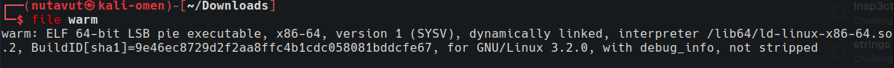
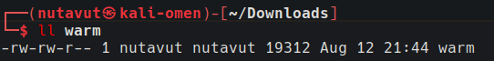
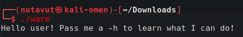
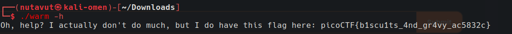

Grant execute permission before running the file.

Use `chmod +x warm` and run it with `./warm`.

The output asks for `-h`, a common help option. Run `./warm -h` to display the help message, which contains the flag in this challenge.

---
