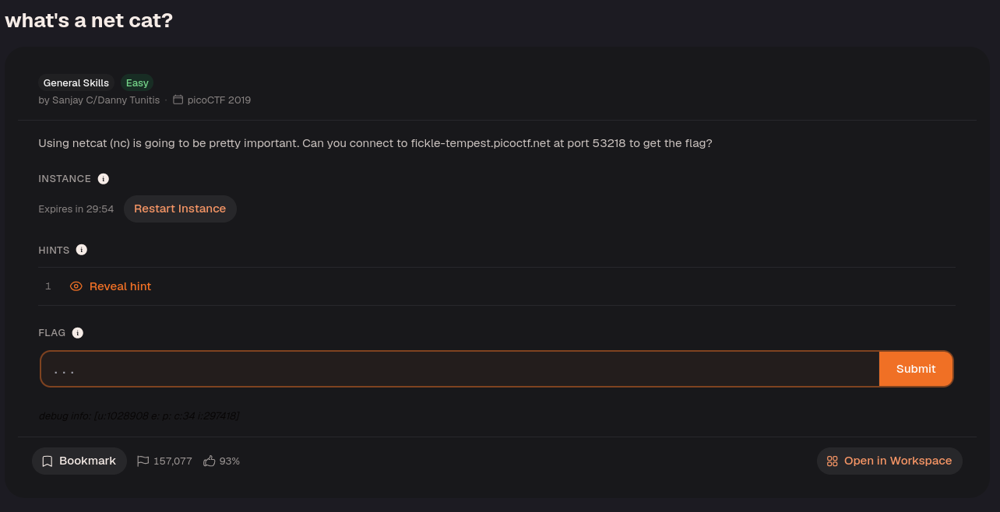
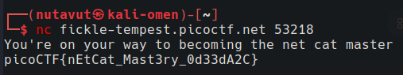

Use this command to get the flag!

`nc` (netcat) connects to the specified host and port and displays the data returned by the service. In this challenge, the service sends the flag when you connect.

---
