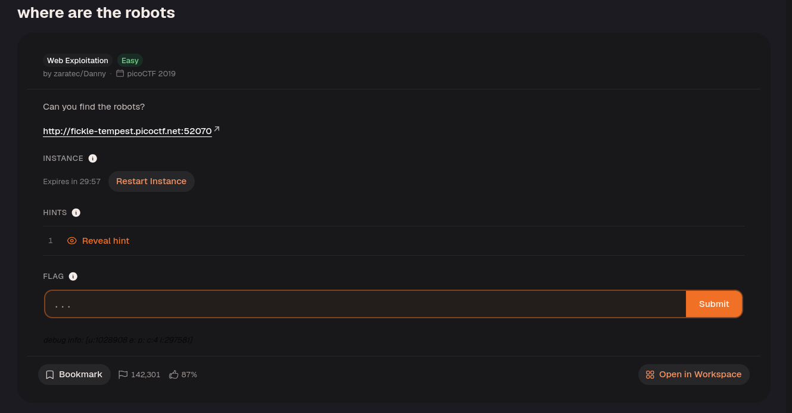
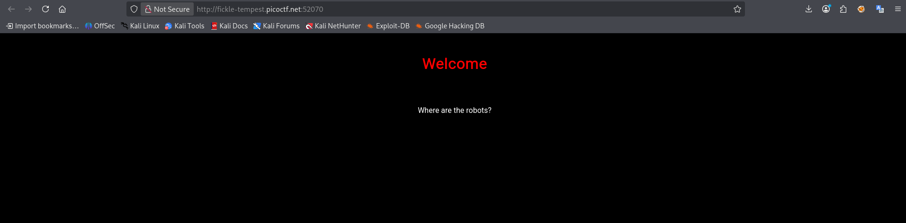
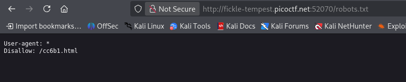
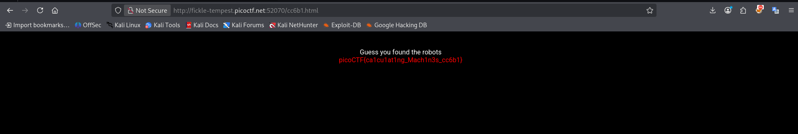

Open the website.

Navigate to `/robots.txt`.

`robots.txt` tells web crawlers which paths they should avoid. Its entries are publicly readable, so a `Disallow` entry can reveal a path worth checking; it does not prevent direct access to that path.

The file reveals a hidden directory.

Here is the flag!

---
